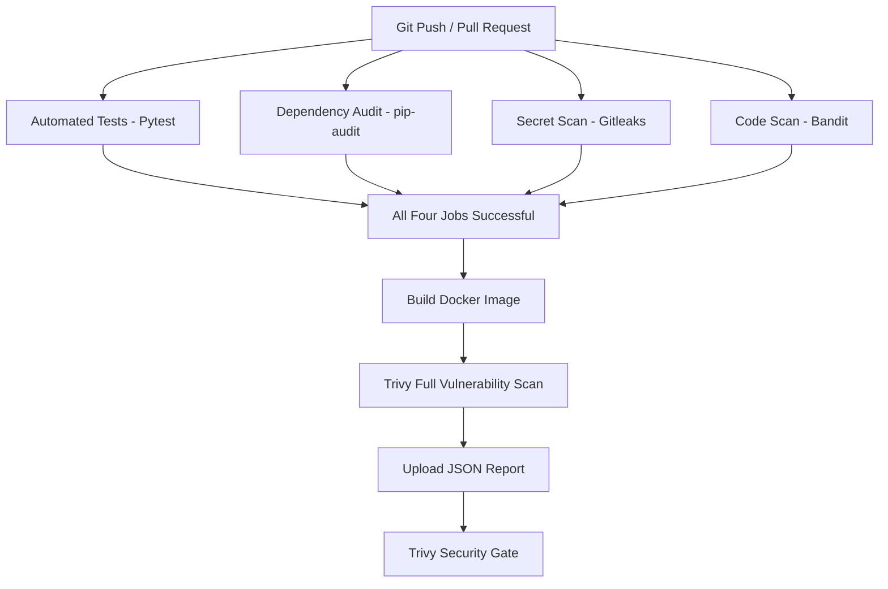

# CI/CD Pipeline

## 1. Overview

AI Helpdesk Copilot uses GitHub Actions to automate application testing, dependency auditing, code security scanning, Docker image building and container vulnerability scanning.

The current implementation covers **Continuous Integration (CI)**. Continuous Delivery/Deployment (CD) is planned for a later milestone.

## 2. Workflow Triggers

The workflow is defined in:

`.github/workflows/tests.yaml`

It runs when:

- Code is pushed to the `main` branch.
- A pull request targets the `main` branch.

## 3. CI Pipeline Jobs

The workflow contains five jobs.

### Job 1: Automated Testing

**Tool:** Pytest

- Sets up Python 3.13.
- Installs development dependencies.
- Runs the automated application tests.
- Verifies important application functionality.

Command:

`python -m pytest -v`

### Job 2: Python Dependency Audit

**Tool:** pip-audit

- Installs pip-audit.
- Checks the Python dependencies listed in `requirements-dev.txt`.
- Reports known vulnerabilities in dependencies.

Command:

`python -m pip_audit -r requirements-dev.txt`

### Job 3: Repository Secret Scanning

**Tool:** Gitleaks

- Checks repository history for accidentally committed secrets.
- Uses full Git history during checkout.
- Prevents secret-scanning comments from being automatically posted.

### Job 4: Python Code Security Scanning

**Tool:** Bandit

- Scans the Python backend for common security issues.

Command:

`python -m bandit -r backend`

### Job 5: Docker Image Build and Security Scanning

**Tools:** Docker Buildx and Trivy

This job runs only after the four preceding jobs succeed.

**Docker image build:**

- Builds the application image using the repository Dockerfile.
- Tags the image as `ai-helpdesk-copilot:ci`.
- Loads the image into the GitHub Actions runner.
- Does not push the image to an external registry.

**Trivy vulnerability scanning:**

- Scans operating-system and application-library vulnerabilities.
- Generates a JSON report containing HIGH and CRITICAL findings.
- Uploads the report as a GitHub Actions artifact.
- Retains the report for 30 days.
- Runs a separate security gate that fails for fixable HIGH or CRITICAL findings.

Unfixed findings remain visible in the complete report.

## 4. Pipeline Execution Order

The four quality and security jobs run independently in parallel.

The Docker build and image-scanning job starts only after all four jobs succeed.

## 5. Current CI Status

The Trivy-enabled workflow completed successfully in GitHub Actions.

Example successful workflow run:

- Run: #11
- Commit: `b137e01`
- Status: Successful
- Duration: 1 minute 28 seconds

The container security findings are documented separately in `docs/security-scan.md`.

A successful pipeline does not guarantee that the Docker image contains no known vulnerabilities. Unfixed findings remain subject to security review.

## 6. Current CD Status

Continuous Delivery/Deployment is not yet implemented.

The following tasks remain planned:

- Publish the verified Docker image to Amazon ECR.
- Prepare AWS infrastructure.
- Deploy the application to the selected AWS runtime.
- Automate deployment through GitHub Actions.
- Verify application health after deployment.

## 7. Future Improvements

- Add automated Docker image publishing.
- Add secure AWS authentication for GitHub Actions.
- Automate AWS deployment.
- Introduce deployment verification and rollback procedures.
- Extend monitoring, logging and alerting.

## 8. Related Documentation

- `README.md` — Project overview and setup instructions.
- `docs/progress.md` — Project development milestones.
- `docs/security-scan.md` — Container vulnerability scanning and findings.

---

**Current milestone:** Continuous Integration implemented; Continuous Delivery/Deployment pending.
