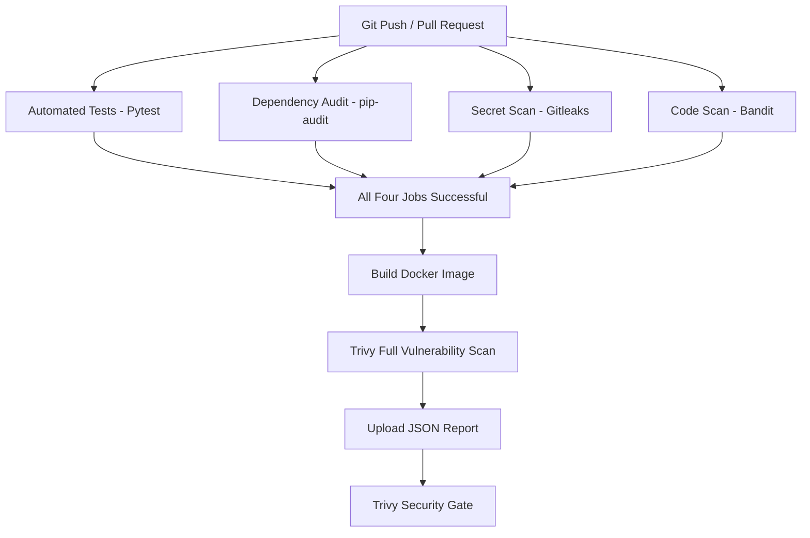

# CI/CD Pipeline

## 1. Overview

AI Helpdesk Copilot uses GitHub Actions to automate application testing, dependency auditing, source-code security scanning, secret scanning, Docker image building, and container vulnerability scanning.

The current implementation covers **Continuous Integration (CI)**. Continuous Delivery/Deployment (CD) is planned for a later milestone. The main project is currently being completed locally; AWS deployment is a later optional extension.

## 2. Workflow Triggers

The workflow is defined in:

`.github/workflows/tests.yaml`

It runs when:

- Code is pushed to the `main` branch.
- A pull request targets the `main` branch.

## 3. CI Pipeline Jobs

The workflow contains five jobs.

### Job 1: Automated Testing

**Tool:** Pytest

- Sets up Python 3.13.
- Installs development dependencies.
- Runs the automated application tests.
- The current locally verified test suite contains 17 passing tests.

### Job 2: Dependency Audit

**Tool:** pip-audit

- Audits Python dependencies for known vulnerabilities.
- Fails the job when the configured audit detects a blocking dependency issue.

### Job 3: Secret Scanning

**Tool:** Gitleaks

- Scans the repository for accidentally committed secrets.
- Produces a SARIF report artifact.

### Job 4: Python Source-Code Security Scan

**Tool:** Bandit

Command:

```bash
python -m bandit -r backend
```

This job checks the backend Python source code for common security issues.

### Job 5: Docker Image Build and Security Scanning

**Tools:** Docker Buildx and Trivy

This job runs only after the four preceding jobs succeed.

**Docker image build:**

- Builds the application image using the repository Dockerfile.
- Tags the image as `ai-helpdesk-copilot:ci`.
- Loads the image into the GitHub Actions runner.
- Does not push the image to an external registry.

**Trivy vulnerability scanning:**

- Scans operating-system and application-library vulnerabilities.
- Generates a JSON report containing HIGH and CRITICAL findings.
- Uploads the report as a GitHub Actions artifact.
- Retains the report for 30 days.
- Runs a separate security gate that fails for fixable HIGH or CRITICAL findings.
- Keeps unfixed findings visible in the complete report.

The security gate is not a guarantee that the image contains zero known vulnerabilities. The complete Trivy report remains available for review.

## 4. Pipeline Execution Order

The four quality and security jobs run independently in parallel. The Docker build and image-scanning job starts only after all four jobs succeed.



## 5. Current CI Status

The latest workflow triggered by commit `89567e6` on branch `main` completed successfully, as confirmed during the project work on November 12, 2026. The workflow run number and duration were not recorded in the available verification notes.

An earlier successful Trivy-enabled workflow run was recorded as:

- Run: #19
- Commit: `b98883f`
- Branch: `main`
- Status: Successful
- Duration: 1 minute 31 seconds
- Artifacts: 3

### November 12, 2026 — zlib Security Fix

An earlier CI scan identified two fixable HIGH vulnerabilities in Debian's `zlib1g` package: `CVE-2026-76844` and `CVE-2026-85091`.

The Dockerfile was updated to upgrade `zlib1g` to `1:1.3.dfsg+really1.3.1-1+deb13u1`. The local image package version was verified, the 15-test Python suite passed at the time of that fix, and GitHub Actions Run #19 passed the Docker image security gate.

The complete Trivy JSON report remains available as a workflow artifact. The blocking gate checks fixable HIGH and CRITICAL findings; it is not a zero-vulnerability guarantee.

### Latest Readiness and Reliability Test Changes

The application added a database readiness endpoint at `/ready`, with automated tests for successful database access and simulated database failure. The local suite subsequently reported 17 passing tests. GitHub Actions completed successfully for commit `89567e6`.

The container security findings are documented separately in `docs/security-scan.md`.

## 6. Current CD Status

Continuous Delivery/Deployment is not yet implemented.

The following tasks remain planned for a later optional deployment phase:

- Publish the verified Docker image to a container registry such as Amazon ECR.
- Configure secure authentication for the selected deployment environment.
- Prepare the required deployment infrastructure.
- Deploy the application to the selected runtime.
- Automate deployment through GitHub Actions or a GitOps workflow.
- Verify application health after deployment.
- Introduce deployment rollback procedures.

The immediate project path is local Kubernetes with Minikube, followed by Helm, local Terraform/Ansible practice, Argo CD, and Prometheus/Grafana. Real AWS deployment is deferred until after the local portfolio version is complete.

## 7. Future Improvements

- Add automated image publishing when the deployment target is selected.
- Add secure identity and permission configuration for the chosen environment.
- Automate deployment and verification.
- Introduce deployment rollback procedures.
- Extend monitoring, logging, and alerting.

## 8. Related Documentation

- `README.md` — Project overview, features, local setup, and roadmap.
- `docs/progress.md` — Completed work, current status, and roadmap.
- `docs/security-scan.md` — Trivy findings and container security decisions.

---

**Current milestone:** Continuous Integration implemented and verified. Continuous Delivery/Deployment remains pending; the current application deployment learning path is local Kubernetes.
